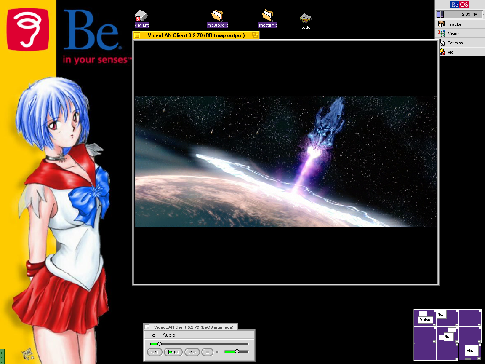
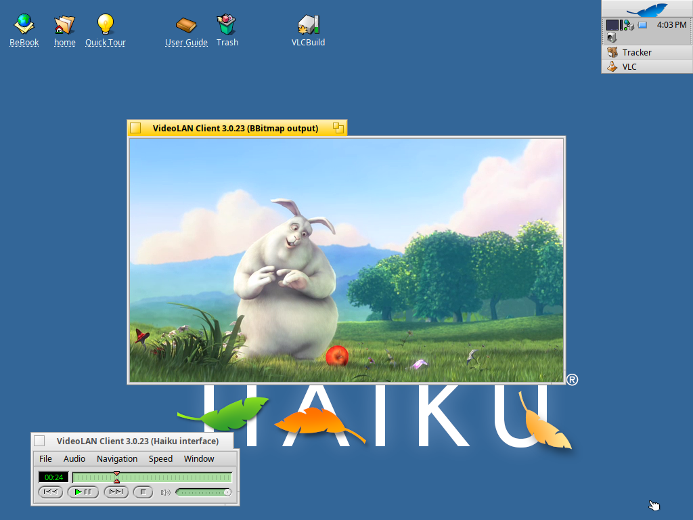
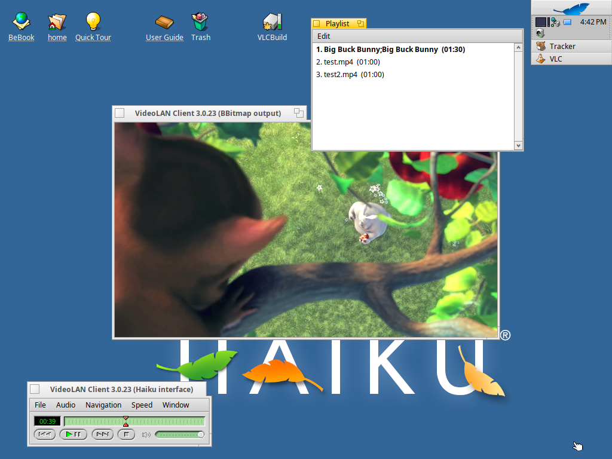

# VLC Reborn

VLC media player for Haiku with its native BeOS-style interface back, and
the **BBitmap video output** as the default, like it was in 2001:

*VLC 0.2.70 on BeOS, April 2001 (screenshot from
[videolan.org](https://images.videolan.org/vlc/screenshots/20010412-00.png))*

VLC used to have a native BeOS interface. It was removed in 2010 (VLC 1.1)
and today's Haiku port uses Qt. VLC Reborn brings the native interface back
to VLC 3.0.23 on Haiku: no Qt.

## What you get

- **Interface window** (“VideoLAN Client 3.0.23 (Haiku interface)”): menu
  bar, seek slider, the BeOS transport buttons (skip back, play/pause,
  skip forward, stop), mute button and volume slider, plus the green LCD
  with file, title, chapter and time.
- **BBitmap video output** (“VideoLAN Client 3.0.23 (BBitmap output)”):
  each video plays in its own window. Frames are decoded into BBitmaps
  and app_server scales them. Window ▸ Fullscreen (Alt+F) fills the
  screen and Esc leaves it; VLC's keyboard shortcuts work in the video
  window.
- Menus: **File** (Open File, Open Disc, Open Location, Open Subtitles,
  About, Quit), **Audio** (audio track, subtitles, volume, mute),
  **Navigation** (previous/next file, title and chapter), **Speed**
  (1/8× to 8×), **Window** (Playlist, Messages, Fullscreen, Always on Top).
- **Playlist** window: double-click an entry to play it, Edit ▸ Remove
  and Remove All.
- **Messages** window with VLC's log, colour-coded as in the BeOS version.
- Files and folders dropped on a VLC window replace the playlist and
  play; File ▸ Open File adds to it.

## Install

Download the `.hpkg` from the
[latest release](https://github.com/idumych/vlc-reborn/releases/latest)
and install it from a Terminal. It needs Haiku R1/beta6 with the current
updates (hrev59866_92 or later; run SoftwareUpdater first if pkgman
complains about `haiku`), x86_64:

    pkgman install ./vlc-3.0.23-3-x86_64.hpkg

pkgman also installs the libraries VLC needs from HaikuPorts. The package
replaces HaikuPorts' `vlc` (it is the same version with a newer revision);
a later VLC update from HaikuPorts would replace it again.

Start it from the Deskbar (Applications ▸ VLC media player), by dropping
files on its window, or with `vlc file.mp4` in a Terminal.

To have VLC offered in Tracker's “Open with…” menu for audio and video
files, register it once:

    mimeset -apps -f "/boot/system/apps/VLC media player"

## Build it yourself

The package is built with
[HaikuPorter](https://github.com/haikuports/haikuporter). Copy
[`haikuports/media-video/vlc`](haikuports/media-video/vlc) into your
HaikuPorts tree, replacing the existing `vlc` directory, then:

    haikuporter --get-dependencies vlc

To work on the code, this repository is the VLC 3.0.23 source with
HaikuPorts' Haiku patch and the VLC Reborn changes as separate commits:

1. `VLC 3.0.23`: the upstream release tarball
2. `Add Haiku support`: HaikuPorts' patch (by Gerasim Troeglazov and the
   HaikuPorts team)
3. `Haiku: native interface and BBitmap video output by default`: VLC Reborn

`haikuports/media-video/vlc/patches/vlc-3.0.23.patchset` is commits 2 and 3
as one file (`git format-patch --stdout HEAD~2`, run on commit 3).

## Where the code is

| Path | What |
|---|---|
| [`modules/gui/haiku/`](modules/gui/haiku) | The interface: VLC 0.8's BeOS interface (Tony Castley, Stephan Aßmus, Eric Petit and others) ported to VLC 3 |
| [`modules/video_output/haiku.cpp`](modules/video_output/haiku.cpp) | BBitmap video output (`--vout=bbitmap`; `--no-haiku-vout-filter` turns smooth scaling off) |
| [`modules/audio_output/haiku.cpp`](modules/audio_output/haiku.cpp) | Media Kit audio output (HaikuPorts) |
| [`src/haiku/application.cpp`](src/haiku/application.cpp) | The `BApplication` the plugins share; when LibVLC runs inside another Haiku app, that app's `be_app` is used |

## Tested

Tested with the release package on Haiku R1/beta6 (hrev59866_92),
x86_64, in VirtualBox: playback with sound, pause and resume, seeking,
volume, skipping to the next and previous file, fullscreen in and out
(Alt+F, menu, Esc), closing the video window (stops playback), audio
track menu, playlist (double-click to play, durations), messages window,
Open File panel, dropping files and a folder from Tracker on the
interface, video and playlist windows, Edit ▸ Remove, “Open with…”
from Tracker, starting from the Deskbar launcher, quitting with Alt+Q
and through the application (as the Deskbar does).

Not tested: real hardware, Renku OS, the 32-bit x86 build, DVDs and other
discs, subtitles files, network streams.

## Known issues

- In VirtualBox, the audio output sometimes resynchronises, mostly when
  a video starts or the system is busy ("playback too late" in the
  messages window; in tests, at most once per 30 seconds of playback).
  You may hear a short skip when that happens.
- In VirtualBox, VLC drops some video frames right after a file starts
  or after seeking ("More than 11 late frames" in the messages window).
- Folders are only checked for DVD contents when they are called
  `VIDEO_TS` or contain one: on Haiku, libdvdread crashes while scanning
  other folders.
- There is no preferences window yet (the BeOS one used APIs that VLC 3
  no longer has). Settings can be changed in `~/config/settings/vlc/vlcrc`
  or on the command line (`vlc -H` lists them).

## Licence

VLC is free software under the GNU GPL version 2 or later; see
[COPYING](COPYING). The interface code comes from VLC's own history
(`modules/gui/beos`, removed in commit `af691d06ec`).

The clip in the screenshots is from *Big Buck Bunny*, © Blender
Foundation, www.bigbuckbunny.org (CC BY 3.0).
