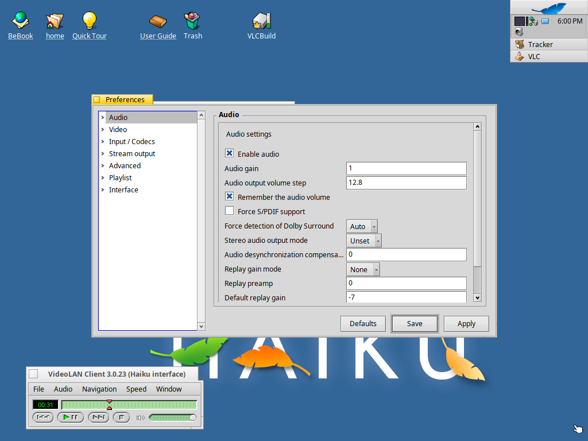
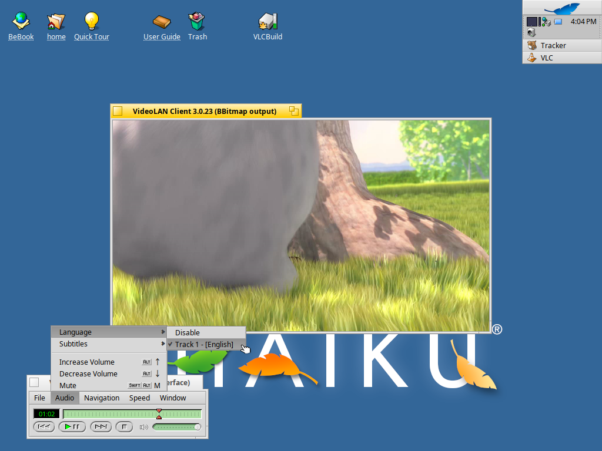
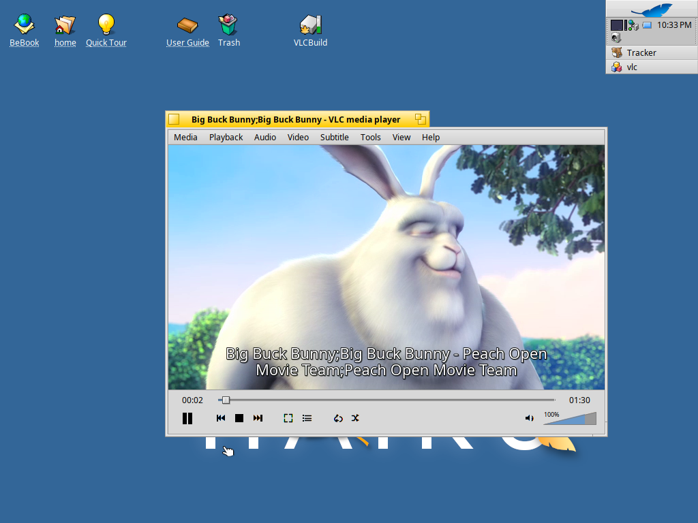
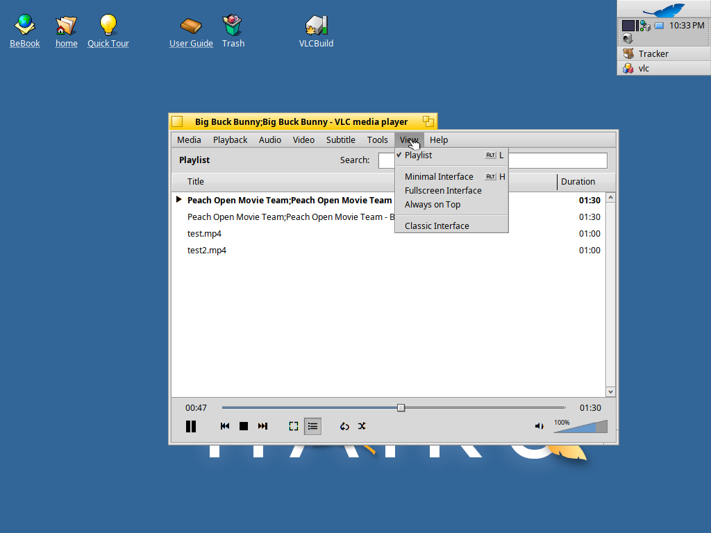
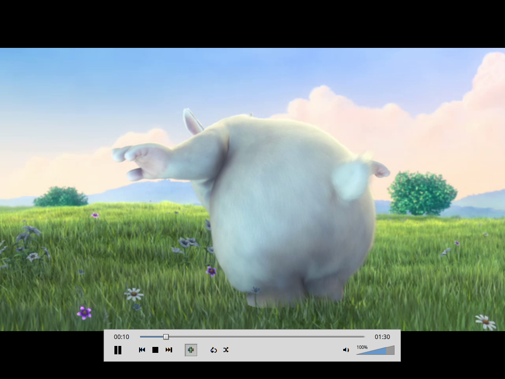
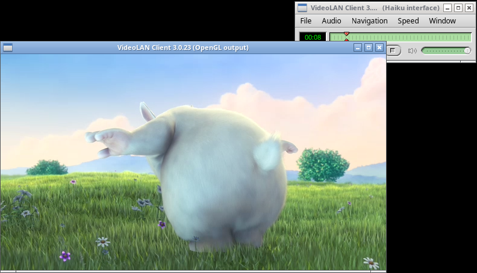

# VLC Reborn

VLC media player with its native BeOS-style interface back, and the
**BBitmap video output** as the default, like it was in 2001:

*VLC 0.2.70 on BeOS, April 2001 (screenshot from
[videolan.org](https://images.videolan.org/vlc/screenshots/20010412-00.png))*

VLC used to have a native BeOS interface. It was removed in 2010 (VLC 1.1)
and today's Haiku port uses Qt. VLC Reborn brings the native interface back
to VLC 3.0.23, with no Qt, on two platforms:

| Platform | Package | Architectures |
|---|---|---|
| Haiku R1/beta6 | `.hpkg` | x86_64 |
| Linux (any desktop, X11 or Wayland) | AppImage, with [Hokku](https://github.com/idumych/hokku) (the Haiku API as a library) | x86_64, aarch64 |

## What you get

- **Interface window** (“VideoLAN Client 3.0.23 (Haiku interface)”): menu
  bar, seek slider, the BeOS transport buttons (skip back, play/pause,
  skip forward, stop), mute button and volume slider, plus the green LCD
  with file, title, chapter and time.
- **BBitmap video output** (“VideoLAN Client 3.0.23 (BBitmap output)”):
  each video plays in its own window. Frames are decoded into BBitmaps
  and the window server scales them. Window ▸ Fullscreen fills the screen
  and Esc leaves it; VLC's keyboard shortcuts work in the video window.
- **OpenGL video output** (“VideoLAN Client 3.0.23 (OpenGL output)”): the
  same window, drawn with VLC's OpenGL renderer in a BGLView. Choose it in
  Preferences ▸ Video ▸ Output modules, or with `--vout=haiku_gl`.
- Menus: **File** (Open File, Open Disc, Open Location, Open Subtitles,
  About, Quit), **Audio** (audio track, subtitles, volume, mute),
  **Navigation** (previous/next file, title and chapter), **Speed**
  (1/8× to 8×), **Window** (Playlist, Messages, Preferences, Fullscreen,
  Always on Top).
- **Preferences** window: every VLC setting, in a tree of categories and
  plugins built from VLC's own options, as in the BeOS version. Save
  writes VLC's settings file.
- **Playlist** window: double-click an entry to play it, Edit ▸ Remove
  and Remove All.
- **Messages** window with VLC's log, colour-coded as in the BeOS version.
- Files and folders dropped on a VLC window replace the playlist and
  play; File ▸ Open File adds to it.

### The modern interface

VLC 3's own interface, rebuilt with Haiku views instead of Qt: the video
plays inside the main window, above the seek bar and the controls (play,
previous, stop, next, fullscreen, playlist, loop, random, volume), and the
window fits itself to the video. Choose it with View ▸ Classic Interface /
Window ▸ Modern Interface (the switch is live: a playing video moves to the
other window and carries on where it was), in Preferences (Interface
style, in the Haiku interface's settings), or with
`--haiku-interface=modern`. The choice is remembered.

- VLC 3's menus: **Media** (Open File, Open Folder, Open Disc, Open Network
  Stream, Open Location from clipboard, Open Recent Media, Save Playlist to
  File, Quit at the end of playlist), **Playback** (title, chapter,
  program, speed, jumps, Jump to Specific Time), **Audio** (track, stereo
  mode, volume), **Video** (track, fullscreen, always on top, zoom, aspect
  ratio, crop, deinterlace, snapshot), **Subtitle**, **Tools** (Media and
  Codec Information, Messages, Preferences), **View** (docked playlist,
  minimal interface, fullscreen interface) and **Help**. Right-click the
  video for the same menus.
- The docked playlist with title, album and duration columns and a search
  field; drop files on it to add them.
- Fullscreen with a floating controller that appears when the mouse moves.
- Both video outputs (BBitmap and OpenGL) draw in the window.

On Linux, through Hokku, VLC looks the same, here with the OpenGL output:

## Install

Download the package for your system from the
[latest release](https://github.com/idumych/vlc-reborn/releases/latest).

**Haiku R1/beta6** (with the current updates, hrev59866_92 or later; run
SoftwareUpdater first if pkgman complains about `haiku`):

    pkgman install ./vlc-3.0.23-5-x86_64.hpkg

pkgman also installs the libraries VLC needs from HaikuPorts. The package
replaces HaikuPorts' `vlc` (the same version with a newer revision); a
later VLC update from HaikuPorts would replace it again. To have VLC in
Tracker's “Open with…” menu for audio and video files, register it once:

    mimeset -apps -f "/boot/system/apps/VLC media player"

**Linux** (glibc 2.39 or newer: Ubuntu 24.04, Debian 13, Fedora 40 and
later):

    chmod +x VLC-3.0.23-x86_64.AppImage && ./VLC-3.0.23-x86_64.AppImage

(`-aarch64` on ARM.) Everything VLC needs is inside, including Hokku; it
uses the desktop's sound server (PulseAudio or PipeWire).

Start it from the menu, by dropping files on its window, or with
`vlc file.mp4`.

## Build it yourself

- **Haiku:** with [HaikuPorter](https://github.com/haikuports/haikuporter).
  Copy [`haikuports/media-video/vlc`](haikuports/media-video/vlc) into your
  HaikuPorts tree, replacing the existing `vlc` directory, then
  `haikuporter --get-dependencies vlc`.
- **Linux:** [`packaging/appimage/build-appimage.sh`](packaging/appimage/build-appimage.sh),
  on Ubuntu 24.04; see [`.github/workflows/appimage.yml`](.github/workflows/appimage.yml).
- Anywhere else with the Haiku API: `./configure --enable-haiku-api
  HAIKU_API_CFLAGS=… HAIKU_API_LIBS=…` ([`packaging/build-vlc.sh`](packaging/build-vlc.sh)).

The AppImages are built by GitHub Actions, natively on each
architecture.

This repository is the VLC 3.0.23 source with HaikuPorts' Haiku patch and
the VLC Reborn changes as separate commits:

1. `VLC 3.0.23`: the upstream release tarball
2. `Add Haiku support`: HaikuPorts' patch (by Gerasim Troeglazov and the
   HaikuPorts team)
3. The VLC Reborn commits after it

`haikuports/media-video/vlc/patches/vlc-3.0.23.patchset` holds the source
commits from 2 on (`git format-patch --stdout 5a9d488..HEAD -- .`, leaving
out the packaging files).

## Where the code is

| Path | What |
|---|---|
| [`modules/gui/haiku/`](modules/gui/haiku) | The interface: VLC 0.8's BeOS interface (Tony Castley, Stephan Aßmus, Eric Petit and others) ported to VLC 3, with its preferences window; and the modern interface (`Modern*.cpp`), which also provides the video output's window (`VOUT_WINDOW_TYPE_HAIKU`, a BView) |
| [`modules/video_output/haiku.cpp`](modules/video_output/haiku.cpp) | BBitmap video output (`--vout=bbitmap`; `--no-haiku-vout-filter` turns smooth scaling off), and built again as the OpenGL output in a BGLView (`--vout=haiku_gl`) |
| [`modules/audio_output/haiku.cpp`](modules/audio_output/haiku.cpp) | Media Kit audio output, Haiku only (HaikuPorts) |
| [`src/haiku/application.cpp`](src/haiku/application.cpp) | The `BApplication` the plugins share; when LibVLC runs inside another Haiku app, that app's `be_app` is used |

## Tested

- **Haiku R1/beta6** (hrev59866_92), x86_64, in VirtualBox: playback with
  sound, pause and resume, seeking, volume, skipping files, fullscreen and
  Esc, closing the video window, audio track menu, playlist, messages and
  preferences windows (changing and saving a setting), Open File panel,
  dropping files and folders from Tracker, “Open with…”, the Deskbar
  launcher, quitting, and playback with the OpenGL output (Mesa).
  The modern interface: playback in the window with both video outputs,
  fullscreen and its controller, the docked playlist, the menus and the
  right-click menu, Media and Codec Information, playing to the end,
  switching to the classic interface and back while a video plays, and
  quitting while windowed, in fullscreen and with other windows open.
- **Linux**: on Ubuntu 24.04 in CI, both AppImages start and draw their
  window under X11 (Xvfb) and Wayland (sway); the x86_64 AppImage played
  a video under Xvfb, with the BBitmap and the OpenGL output (NVIDIA, EGL).
  On a KDE Plasma (Wayland) laptop with two monitors: the preferences
  window's pop-up menus.
- The modern interface was only tested on Haiku, not yet on Linux.
- Not tested: playback on aarch64, Renku OS, DVDs and other
  discs, subtitle files, network streams.

## Known issues

- Haiku has no arm64 build: HaikuPorts has no arm64 packages yet, so
  VLC's libraries (FFmpeg and others) don't exist for arm64 Haiku.
- In VirtualBox, the audio output sometimes resynchronises, and some video
  frames are dropped, right after a file starts or when the system is busy.
- Folders are only checked for DVD contents when they are called
  `VIDEO_TS` or contain one: on Haiku, libdvdread crashes while scanning
  other folders.
- On Linux, the window manager places the windows; they may overlap.

## Licence

VLC is free software under the GNU GPL version 2 or later; see
[COPYING](COPYING). The interface code comes from VLC's own history
(`modules/gui/beos`, removed in commit `af691d06ec`). Hokku, bundled in
the AppImages, is under the MIT licence.

The clip in the screenshots is from *Big Buck Bunny*, © Blender
Foundation, www.bigbuckbunny.org (CC BY 3.0).
